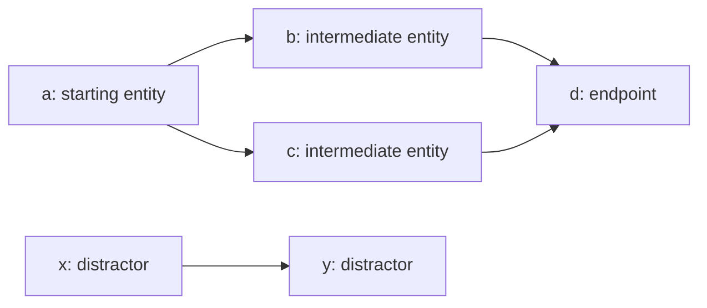

# Рабочий разбор разделов статьи

Этот файл дополняет [общий план статьи](ARTICLE_PLAN_WWW2027.md). Здесь последовательно разбираем разделы: сначала фиксируем определения и подтверждённые факты, затем готовим текст для статьи и закрываем открытые вопросы. Новые разделы будем добавлять по мере работы.

Согласованные английские разделы собираем в [итоговом файле статьи](ARTICLE.md). Разделы Task and Benchmark Construction и Experimental Design and Evaluation перенесены туда 24 октября 2026.

Текущий раздел: **4. Experimental Design and Evaluation**. Версия 0.8 от 24 октября 2026. Разделы 3 и 4 согласованы и перенесены в итоговый файл. Здесь сохраняются рабочие разборы, согласованные английские тексты и открытые вопросы для последующей доработки статьи.

Обозначения статьи: **Raw** — исходные описания и метаданные; **Raw+E** — те же карточки с добавленными явными отношениями (*E = explicit relations*). Соответствие архиву: `Raw` = `Braw`, `Raw+E` = `Braw+E`; имя серии в данных — `full_braw`.

## 3. Task and Benchmark Construction

### 3.1. Что должен объяснить раздел

После чтения этого раздела должно быть понятно:

1. Что получает модель и что она должна выбрать.
2. Как определяется правильное множество сущностей.
3. Как связаны вопрос, структура мотива и поддерживающие маршруты.
4. Как формируются кандидаты, отвлекающие сущности и представления фактов.
5. Какие свойства подтверждены сохранёнными данными и где проверка ограничена.

Плановый объём в статье — около 1,25 страницы. Результаты моделей, формулы метрик, параметры API и статистические тесты относятся к следующим разделам.

### 3.2. Исходный граф и формальная постановка

**Источник графа и ранее описанный метод.** Пользователь указал в качестве источника свою статью [Kirpichev et al., 2026, *Towards Ontology-Driven Multi-Hop Benchmark for Corporate GraphRAG Systems*](https://openreview.net/forum?id=1vQ04i1XGC), представленную на IJCAI-ECAI 2026 Joint Workshop on GenAIK and NORA. Локальный [PDF](../11_Towards_Ontology_Driven_Mul.pdf) прочитан; построение графа описано в §3.1 на страницах 3–5. Статус long research paper и ссылка на OpenReview подтверждаются [официальной программой workshop](https://genetasefa.github.io/GenAIK2026/).

В статье описаны следующие источники и этапы:

- Онтологическое ядро компаний S&P 500 с иерархией GICS «сектор — отрасль — компания».
- Описания компаний из Yahoo Finance и Wikipedia; извлечение продуктов и ресурсов с помощью Qwen2.5-7B-Instruct с созданием связей `PRODUCES` и `REQUIRES`.
- Структурированные финансовые metadata для руководителей и институциональных инвесторов, а также географический слой City/State/Country.
- Новости через GDELT, присоединяемые типизированными отношениями к сущностям графа.

Предыдущая статья сообщает о **49 017 узлах и 70 162 отношениях**. Эти числа относятся к описанному там графу; пока не подтверждено, что текущий экспериментальный snapshot имеет ровно те же counts. Формулировка о новостях «за последние три месяца» также не задаёт точные календарные границы текущей выборки.

**Разграничение вклада.** Предыдущая работа описывает построение корпоративного KG, graph-grounded QA benchmark и сравнение систем RAG. В новой статье используем этот графовый ресурс для другой задачи — отбора сущностей из фиксированного пула при контролируемом изменении предъявленных свидетельств. Не представляем построение исходного KG как новый вклад и не называем текущие motif-задачи переработкой прежних 4998 QA без сопоставления записей.

Для двойного слепого рецензирования используем обычную ссылку в третьем лице: **“the corporate knowledge graph described by Kirpichev et al.”**, без формулировки “our previous work”. Запись BibTeX: [`kirpichev2026towards`](ARTICLE_REFERENCES.bib). DOI, страницы и номер тома proceedings пока не установлены и не добавлены.

**Постановка задачи.**

Рассматриваем ориентированный типизированный граф знаний:

$$
G=(V,\mathcal{R},E,\tau,x),\qquad E\subseteq V\times\mathcal{R}\times V,
$$

где $V$ — сущности, $\mathcal{R}$ — типы отношений, $\tau(v)$ — тип сущности, а $x(v)$ — её атрибуты и текстовые описания. Наличие типа отношения в графе не означает, что каждый вопрос фильтрует маршруты по этому типу: в текущих endpoint-вопросах основными ограничениями служат направление, глубина и, для цепочек, тип конечной сущности.

Базовая задача задаёт именованную стартовую сущность $a$, правило обхода $q$ и множество кандидатов $C\subseteq V$, содержащее $a$, с зафиксированным порядком предъявления. В основных панелях $|C|=25$. Для графового определения задачи используется индуцированный контекст:

$$
E_C=\{(u,r,v)\in E:u,v\in C\},\qquad G[C]=(C,E_C).
$$

Модель получает текст вопроса и публичные карточки кандидатов. Карточка содержит имя, тип и разрешённые в данном условии факты; полный граф и приватный reference ей не предъявляются. Требуемый выход — множество публичных имён $\widehat W\subseteq\operatorname{names}(C)$. Имена однозначно различают кандидатов внутри задачи; при отображении $n_C$ из сущностей в публичные имена целевой ответ имеет вид $n_C(W_q)$. Порядок имён в ответе не задаёт порядок обхода.

**Нужно различать три множества.**

- $M$ — узлы выбранного исходного мотива, до добавления отвлекающих кандидатов.
- $A_q$ — конечные сущности, составляющие ответ на endpoint-вопрос.
- $W_q$ — все сущности, покрывающие поддерживающие маршруты по правилам вопроса, включая стартовую сущность.

Обозначим через $\mathcal P_q(G[C],a)$ множество простых маршрутов, разрешённых вопросом, начинающихся в $a$ и содержащих хотя бы один переход. Внутри маршрута сущность не посещается повторно. Для входящих вопросов обход идёт против направления рёбер: порядок посещения «anchor → predecessor» не означает, что в исходном графе существует ребро anchor → predecessor.

Для принятых задач с непустым множеством поддерживающих маршрутов:

$$
A_q=\{\operatorname{last}(p):p\in\mathcal P_q(G[C],a)\},\qquad
W_q=\bigcup_{p\in\mathcal P_q(G[C],a)}V(p).
$$

Это определение относится к controlled endpoint-постановке. Для native/legacy серий в архиве используются сохранённые графовые references; нельзя автоматически объявлять каждый из них независимо перепроверенным $W_q$.

**Цель отбора — восстановить $W_q$, а не только $A_q$.** Это выбранная конвенция оценки покрытия маршрутов. Она не утверждает, что факты каждой выбранной карточки необходимы для ответа. Например, связь с сущностью может быть целиком описана на карточке её соседа.

Также нельзя без проверки отождествлять $M$ и $W_q$. Дополнительный кандидат иногда может входить в новый путь к уже имеющемуся endpoint, не меняя $A_q$. Текущий oracle различает эти случаи; материализация сохраняет witnesses полного кандидатного контекста. Совпадение записанных reference IDs и witness IDs в проверенной controlled части архива — свойство этих сохранённых записей, а не общий математический инвариант.

### 3.3. Пример: один ответ, два поддерживающих пути

Схематический пример ромба; в рисунке показано меньше кандидатов для читаемости. В экспериментальной основной панели их 25.

Вопрос: *Starting from a, follow every outgoing route for two links and report all distinct endpoints.*

- Конечный ответ: $A_q=\{d\}$.
- Поддерживающие маршруты: $(a,b,d)$ и $(a,c,d)$.
- Цель отбора: $W_q=\{a,b,c,d\}$.
- Множество $\{a,b,d\}$ содержит один путь к правильному ответу, но не покрывает второй маршрут и потому неполно по принятой конвенции.
- Кандидаты $x,y$ не относятся к целевому множеству, хотя могут быть связаны друг с другом.

Для статьи этот пример лучше объединить с рисунком экспериментального дизайна. Это иллюстрация определения, а не дополнительный эксперимент.

### 3.4. Мотивы и семантика вопросов

В Core представлены семь семейств, по 100 базовых задач на семейство:

- **Chain, 6 узлов:** обход по исходящим связям до первого узла заданного типа на каждом простом маршруте. Ветвь, не достигшая требуемого типа, не даёт endpoint и не входит в поддерживающие маршруты ответа.
- **Star-in, 6 узлов:** непосредственные предшественники стартовой сущности.
- **Star-out, 6 узлов:** непосредственные последователи стартовой сущности.
- **Tree-in, 6 узлов:** концы маршрутов из двух входящих переходов; маршрут завершается раньше, если дальнейший разрешённый переход невозможен.
- **Tree-out, 6 узлов:** аналогичное правило для исходящих переходов.
- **Rhombus, 4 узла:** исходящие маршруты до двух переходов с альтернативными путями к общей конечной сущности.
- **Hourglass, 5 узлов:** непосредственные входящие и исходящие соседи центральной сущности; endpoint-ответ различает эти две группы.

В двухшаговых controlled вопросах endpoint — конец двухшагового маршрута или более короткого тупикового маршрута. Это не определение «все узлы на расстоянии не более двух». Промежуточные узлы входят в $W_q$, даже если они не входят в $A_q$.

Увеличенная сетка размеров в реестре: chain 3–6; star-in/star-out 3–10; tree-in/tree-out 5–10; rhombus 4; hourglass 5. Поддержка размера генератором не означает, что каждая комбинация выполнена для всех моделей и условий. Точное покрытие серий приводится в Experimental Design.

**Ограничение интерпретации:** мотив меняет и топологию, и операцию запроса. Поэтому сравнение chain и tree нельзя описывать как изолированное вмешательство только в форму графа.

### 3.5. Формирование кандидатного контекста

Ниже описана логика текущего кода построения. Исторические выборки следует описывать вместе с их сохранёнными входами и метаданными; параметры нынешней конфигурации не заменяют отсутствующий журнал исходного построения.

1. **Выбор мотива.** Из исходного графа выбираются узлы и типизированные направленные связи нужной структуры. Текущие samplers проверяют точную индуцированную структуру на выбранных узлах; это не гарантирует, что полный граф ацикличен.
2. **Определение запроса.** Фиксируются anchor, направление, глубина или условие остановки по типу. Текущая controlled подготовка разделяет компактную целевую и процедурную формулировки с общей семантикой.
3. **Добавление кандидатов.** Узлы мотива дополняются до 25. Порядок кандидатов сохраняется внутри соответствующих пар представлений; между вариантами шума состав и порядок могут меняться.
4. **Формирование фактов.** Для controlled представлений используется набор отношений индуцированного кандидатного контекста, включая допустимые связи отвлекающих сущностей. Gold membership не является фильтром предъявляемых фактов.
5. **Фиксация задачи.** Публичный вход хранится отдельно от приватных IDs, references, семантических спецификаций и результатов аудита. Сопоставление условий выполняется по идентификатору базовой задачи.

**Два основных вида отвлекающего контекста:**

- *Disconnected:* отвлекающие сущности не имеют рёбер к узлам исходного мотива в обе стороны. Между самими отвлекающими сущностями связи возможны. Текущий builder подбирает кандидатов типов, представленных в мотиве, и старается обеспечить реальные альтернативы по типу.
- *Adjacent:* часть отвлекающих сущностей соседствует с мотивом. В текущем builder они проходят проверку сохранения графового reference; остальные места заполняются несвязанными кандидатами. Ограничение типов несвязанных кандидатов не переносится автоматически на смежных. Текущая конфигурация допускает **до 10**, а не обязательно ровно 10 смежных кандидатов.

Шум здесь меняет не только «близость» сущностей: меняются их идентичности, состав контекста и плотность связей. Отдельно современный endpoint-аудит проверяет сохранение $A_q$ и групп входящих/исходящих ответов; это не тождественно требованию $W_q=M$.

### 3.6. Предъявление фактов и имён

Для понимания построения достаточно описать основные семейства; полная матрица кодов условий относится к Experimental Design.

- **Controlled evidence:** типы сущностей и факты, полученные из графа. Те же отношения представлены как явные тройки, предложения фиксированных шаблонов или связываемые атрибуты. В текстовом условии используются шаблонные утверждения, а не произвольные естественные описания.
- **Native metadata:** исходные атрибуты карточек, например описания компаний, заголовки и тексты новостей, URL и даты. Raw+E дополняет такие карточки явными отношениями. Частный графовый reference сам по себе не доказывает, что исходный текст содержит все нужные свидетельства.
- **Names and types only:** контрольные условия без предъявленных фактов отношений. Здесь инструкции допускают прежние знания о распознаваемых именах и предусматривают сигнал о недостатке свидетельств; это отдельный режим, а не положительный пример достаточного контекста.
- **Real names / pseudonyms:** имена заменяются согласованно в вопросе, карточках и ссылках. Архивные псевдонимы заморожены; не приписываем им свойства текущего генератора без проверки. Замена имён не гарантирует равенства токенизации.

Статические карточки и последовательное раскрытие используют разные режимы доступа к фактам. Детали incremental-протокола следует дать в Experimental Design, а не смешивать с определением графового reference.

**Проверенный частный случай Raw/Raw+E:** все 10 200 пар «модель × базовая задача» совпадают по системным сообщениям, вопросам, упорядоченным кандидатам и приватным references. После удаления полей `facts.relations` из Raw+E публичный вход совпадает с Raw. Поэтому именно архивную full_braw-панель можно описывать как парное добавление явных отношений. Это не распространяет вывод о сопоставимости на произвольное сравнение native и controlled серий.

### 3.7. Масштаб, references и границы проверки

Core включает 700 базовых задач и 27 300 наблюдений: 700 × 13 условий × 3 модели. Raw/Raw+E содержит по 3400 базовых ID для каждой модели и 20 400 наблюдений. Эти числа нельзя складывать как количества независимых графов: задачи повторяются между условиями и могут переиспользоваться между сериями.

Полный архив включает 60 088 наблюдений разных серий. Для данного раздела важнее определения популяций, чем общее число прогонов; полное покрытие вынести в Experimental Design.

Сверка сохранённых входов подтверждает: у всех 59 688 наблюдений вне calibration ровно 25 кандидатов, у 400 calibration-наблюдений — по 5. Во всех немикрозадачах мощность сохранённого gold равна записанному размеру мотива; gold не содержит повторов и полностью входит в пул кандидатов. Это свойства архивных targets, а не доказательство достаточности текстовых свидетельств.

Необходимо разделить:

1. **Controlled graph witnesses:** в Core/size/incremental доступны сохранённые `task_spec` и `graph_witness_ids`.
2. **Native/legacy graph references:** используются сохранённые `reference_names`; не все задачи имеют тот же набор спецификаций, что controlled.
3. **Calibration:** отдельные локальные задачи с собственными ожидаемыми ответами.

Legacy имеет иные формулировки вопросов и конвенции ответа, включая anchor и «within two links». Их нельзя молча переписать как современную endpoint-постановку, где стартовая сущность включена в selection target, но не является дополнительным обязательным endpoint.

Проверка архива подтверждает целостность файлов, связи между записями и пересчёт доступных оценок относительно замороженного gold. Она не является независимым повторным вычислением семантики всех задач по полному исходному графу. Дополнительная сверка 3400 Raw+E-задач подтверждает наличие всех сохранённых reference edges в публичных фактах; в 748 задачах есть также отношения вне gold. Это подтверждает наличие нецелевых связей в предъявленном контексте, но не полноту всех induced edges относительно отсутствующего полного snapshot.

### 3.8. Черновик текста для статьи на английском

Редакционный статус: сокращённая версия с определением задачи, составом выборки и построением входных данных. Детали экспериментальных условий, вспомогательные серии, проверка архива и метрики относятся к другим разделам. Открытые вопросы о версии графа и историческом sampling перечислены ниже, в §3.9.

#### 3. Task and Benchmark Construction

**Source graph.** We use the corporate knowledge graph described by [Kirpichev et al. (2026)](https://openreview.net/forum?id=1vQ04i1XGC). It contains S&P 500 companies, sectors, industries, executives, investors, products, resources, locations, and news. Its construction uses corporate data from Yahoo Finance and Wikipedia and news from GDELT.

**Selection task.** Each main selection task consists of a question and 25 candidate entities. Each entity is presented as a card containing a unique name, an entity type, and the facts available in the experimental condition. The model returns a set of candidate names. For graph-derived tasks, the target set contains the named starting entity, the endpoints requested by the question, and every intermediate entity on every supporting path within the candidate set. Paths follow the question's direction and stopping rule without revisiting an entity. For example, if both $a\to b\to d$ and $a\to c\to d$ satisfy the question, the requested endpoint is $d$, but the selection target is $\{a,b,c,d\}$. The target covers all supporting paths rather than the smallest set of cards sufficient for an answer.

**Task sampling.** The core dataset contains 700 tasks: 100 for each of seven graph patterns (motifs): chains, inward and outward stars, inward and outward trees, rhombi, and hourglasses. Each motif has six entities, except for rhombi with four and hourglasses with five. Chain questions follow outgoing links until the first entity of a specified type. Star questions ask for direct incoming or outgoing neighbors. Tree questions follow incoming or outgoing links for two steps; rhombus questions follow outgoing links for two steps. A two-step path ends earlier only when no unvisited neighbor remains in the required direction. Hourglass questions ask for both incoming and outgoing neighbors. Motif comparisons therefore involve differences in both graph structure and question type.

**Candidate construction.** We add distractors to the sampled motif to obtain 25 candidates. Disconnected distractors have no edges to motif entities, although they may be connected to each other. Adjacent distractors are neighbors of motif entities. The paired noise variants retain the same question and recorded target set but can contain different distractors. Graph-derived inputs include relations involving distractors.

**Evidence formats.** In the main representation comparison, graph relations are presented as triples or sentences generated from fixed templates. Matched representation variants use the same candidates and relations. We also evaluate original entity descriptions, with and without explicit relations added to the cards. Their selection targets come from the graph; the descriptions alone are not assumed to contain every required relation.

### 3.9. Открытые вопросы перед фиксацией раздела

**Метод построения и основные источники теперь установлены по предыдущей статье. Для паспорта конкретного экспериментального среза остаётся уточнить:**

1. Дату и версию экспорта, абсолютные границы новостного окна.
2. Число узлов и рёбер, схему и graph hash текущего snapshot; совпадает ли он со срезом из предыдущей публикации.
3. Соответствие устойчивых entity IDs архивным IDs, версию pipeline и выполненную очистку/дедупликацию.
4. Какие проверки фактической корректности извлечённых отношений выполнены дополнительно к выполнению запросов в базе.
5. Лицензии исходных данных и возможность передать данные рецензентам либо воспроизвести построение.

Neo4j — способ хранения, а не название исходного набора данных. Корректно называть ресурс корпоративным графом из работы Kirpichev et al.; называть весь граф Wikidata или DBpedia оснований нет. Выполнение Cypher подтверждает результат относительно конкретной базы, но само по себе не доказывает истинность извлечённых связей, точность перевода вопроса или отсутствие пересечения с обучающими данными модели.

**Нужно подтвердить процедуру исторического построения:** применённые seed и ограничения повторов anchor; реальное распределение принятия/отбраковки; соответствие текущих samplers исходному pipeline; достаточность native metadata и сохранение reference при добавлении смежных кандидатов. До этого параметры текущей конфигурации описываем именно как параметры текущего кода.

**Редакционное решение для дальнейшего обсуждения:** сохранить явную цель полного покрытия поддерживающих маршрутов. Если переопределять задачу как поиск минимально достаточных карточек, потребуется другой gold и отдельная оценка; это изменит постановку статьи.

### 3.10. Источники внутри проекта

- [Предыдущая статья: локальный PDF](../11_Towards_Ontology_Driven_Mul.pdf), §3.1, страницы 3–5; [публичная карточка OpenReview](https://openreview.net/forum?id=1vQ04i1XGC); [BibTeX](ARTICLE_REFERENCES.bib).
- [Семантика endpoint-вопросов и oracle](../graph_motives/preparation/questions.py): `evaluate_task`, `audit_question_support`, правила остановки и разделение answer/witness.
- [Материализация controlled задач](../graph_motives/preparation/materialize.py): private/public, `graph_witness_ids`, проверка достаточности и пар условий.
- [Выбор мотивов](../graph_motives/graph/motifs.py) и [построение кандидатных пулов](../graph_motives/graph/build.py): текущая процедура sampling и distractors.
- [Выбор панелей](../graph_motives/preparation/panels.py) и [реестр условий](../graph_motives/preparation/registry.py): Core и сетка размеров.
- [Формирование свидетельств](../graph_motives/preparation/evidence.py), [публичная metadata](../graph_motives/graph/metadata.py), [конфигурация](../configs/dataset.toml).
- [Описание архива](../results/README.md), [числа наблюдений](../results/panel_counts.csv), [проверка архива](../graph_motives/verify_archive.py) и [протокол](EXPERIMENT_PROTOCOL.md).

## 4. Experimental Design and Evaluation

### 4.1. Что должен объяснить раздел

Нужно определить сравниваемые модели и условия, единицу наблюдения, процедуру получения ответа и расчёт оценок. Определение самой задачи и мотивов уже дано в разделе 3; здесь его не повторяем. При первом упоминании каждого условия даём код, содержательное название и описание. Затем в таблицах и на осях графиков используем коды; подписи связывают их с определениями этого раздела. Сохраняем существующие обозначения проекта, чтобы не вводить дополнительную перенумерацию.

### 4.2. Проверенный дизайн

**Основные сравнения.** Core включает одни и те же 700 базовых задач в 13 условиях для каждой из трёх моделей: 27 300 наблюдений. Условия задают следующие сравнения:

Рабочее соответствие названий английского черновика архивным кодам: Source-card triples — K1; Source-card triples with adjacent distractors — K2; Destination-card triples — K3; Triples on both cards — K4; Templated text — K5; Templated text with adjacent distractors — K6; Triples with a direct question — K7; Templated text with a direct question — K8; Linked attributes — K5k; Real names with triples — R1-matched; Real names with triples and adjacent distractors — R2-matched; Real names and types only — R0; Pseudonyms and types only — K0.

- **K1** — исходное условие: псевдонимы, явные отношения на карточке субъекта, несвязанные отвлекающие кандидаты и пошагово сформулированный вопрос.
- **Представление:** K1/K5 и K7/K8 — тройки против шаблонного текста; K5/K5k — текст против связываемых атрибутов. В K5k значение атрибута отношения сопоставляется с ключом другой карточки.
- **Шум:** K1/K2 и K5/K6 — несвязанные против смежных отвлекающих кандидатов.
- **Размещение:** K1/K3/K4 — отношение на карточке субъекта, объекта или обоих. Направление отношения сохраняется; K4 дополнительно дублирует каждый факт.
- **Вопрос:** K1/K7 и K5/K8 — пошаговая инструкция против прямого вопроса о той же цели.
- **Имена:** R1-matched/K1 и R2-matched/K2 — реальные имена против псевдонимов при одинаковых прочих факторах.
- **Контроль без отношений:** R0/K0 — только реальные имена или псевдонимы и типы. В этих двух условиях разрешены прежние знания об именах; в остальных controlled условиях разрешены только предъявленные свидетельства.

Raw/Raw+E — 3400 общих базовых задач на условие и модель, всего 20 400 наблюдений. Проверены совпадение вопросов, порядка кандидатов и references и отличие публичных входов только добавленными отношениями. Эти задачи частично пересекаются с Core, поэтому размеры серий нельзя суммировать как независимые задачи.

**Дополнительные серии и их фактическое покрытие:**

- Size: Gemma, 1100 дополнительных задач для K1 и K5, 2200 наблюдений.
- Incremental: Gemma, по 350 эпизодов для K7-inc и K8-inc; сравнение с one-shot выполнять на тех же ID. Выбор карточки раскрывает её факты; из исторических входов сохранены начальные контексты, а не все ходы.
- Calibration: Gemma, четыре локальные операции по 100 примеров, всего 400; по 5 кандидатов.
- Native D: Gemma, 6288 наблюдений по длине описаний, наличию явных отношений и виду шума; при uniform по 696 задач на условие вместо 700.
- Legacy: 2000 наблюдений Gemma и 800 Qwen с отдельными стадиями отбора, ответа и judge. Популяции моделей отличаются; идентификатор исторического judge не установлен. Для основной оценки entity selection эта серия не заменяет controlled сравнения.

**Модели и параметры — по архиву, а не по текущей конфигурации:**

- Qwen: `qwen/qwen3.6-flash`; Ministral: `mistralai/ministral-14b-2512`. Для всех 31 800 Core/Raw запросов этих моделей подтверждены OpenRouter, temperature=0, max_tokens=1024, JSON-object response format и timeout=120 секунд. Только у Qwen явно записано отключение reasoning.
- Gemma Raw: `google/gemma-4-31b-it` подтверждён в 6800 сохранённых ответах. Температура, лимит токенов и transport settings этих запусков не сохранены.
- Gemma Core/size/calibration/incremental: всего 12 400 наблюдений с индивидуальными оценками и замороженными входами, но без исходных ответов и подтверждённых параметров вызова. Метрики этих записей сохраняются; отсутствие raw response само по себе не превращает валидную сохранённую оценку в ноль.
- Gemma Native D: temperature=0 записана в заданиях, но точный served model ID и лимит генерации отсутствуют. Legacy settings — декларированные конфигурации, а не подтверждённые параметры каждого запроса.

Архив содержит один конечный outcome на комбинацию «серия × модель × условие × шум × базовая задача». Transport retries, ходы эпизода и повторение задачи в разных условиях не являются независимыми повторными генерациями. Единую историческую retry policy по текущему runner не восстанавливаем.

### 4.3. Оценки и агрегирование

Для валидного ответа $S$ и непустого эталона $T$:

$$
P=\frac{|S\cap T|}{|S|},\qquad
R=\frac{|S\cap T|}{|T|},\qquad
F_1=\frac{2|S\cap T|}{|S|+|T|},\qquad
EM=\mathbf 1[S=T].
$$

При пустом $S$ все четыре оценки равны нулю. Для каждого условия берём арифметическое среднее индивидуальных оценок по плановому числу задач. Невалидные и неполученные ответы дают нулевой вклад, оставаясь в знаменателе. Таким образом, итоговый F1 — среднее per-task F1, а не micro-F1 и не гармоническое среднее уже агрегированных precision и recall.

Для Core/Raw имена сопоставляются точно; неизвестные или повторные кандидаты нарушают формат ответа. Флаг недостаточности свидетельств сам по себе не делает ответ невалидным и не меняет оценку выбранного множества. Валидный пустой список и невалидный ответ с ошибкой разбора различаются в статусах, хотя при непустом эталоне оба дают ноль. Legacy отдельно нормализует пробелы и регистр; сохранённые неизвестные имена учитываются как false positives.

Долю валидных ответов необходимо показывать рядом с основными метриками. Иначе снижение качества отбора невозможно отличить от нарушения протокола. Для 15 неполученных Ministral Raw ответов действует тот же плановый знаменатель; исключать их из среднего нельзя.

### 4.4. Английский черновик

Статус: согласован и перенесён в [итоговый файл](ARTICLE.md#4-experimental-design-and-evaluation) 24 октября 2026. Здесь сохранена та же английская версия. Доверительные интервалы, тесты значимости и дополнительные baselines не объявлены выполненными; открытые вопросы перечислены в §4.5.

#### 4. Experimental Design and Evaluation

**Models and task sets.** We compare Gemma-4-31B, Qwen3.6-Flash, and Ministral-14B-2512. The core evaluation applies 13 conditions to the same 700 base tasks for each model, giving 27,300 evaluations. A second comparison uses 3400 tasks per model under two conditions: **Raw — Original descriptions**, containing the original entity metadata, and **Raw+E — Original descriptions with explicit relations**, adding graph relations to the same cards. Here, E denotes explicit relations. This gives 20,400 evaluations. The two task sets overlap. Within each experiment, each task contributes one final outcome per model, condition, and noise variant; transport retries are not independent repetitions.

**Experimental conditions.** Unless specified otherwise, conditions use pseudonyms, disconnected distractors, a step-by-step question, and facts on source cards. Entity types remain visible throughout. The 13 conditions and their codes are:

- **K1 — Source-card triples:** each directed relation is shown as a triple on its source entity's card. This is the reference setting.
- **K2 — Source-card triples with adjacent distractors:** the same representation with distractors connected to the motif.
- **K3 — Destination-card triples:** each triple appears on its destination entity's card; the relation direction is unchanged.
- **K4 — Triples on both cards:** each triple is duplicated on its source and destination cards.
- **K5 — Templated text:** each relation is expressed as a sentence generated from a fixed template.
- **K6 — Templated text with adjacent distractors:** the same text representation with distractors connected to the motif.
- **K7 — Triples with a direct question:** source-card triples with the step-by-step instructions replaced by a direct question about the same endpoints.
- **K8 — Templated text with a direct question:** the same question change applied to templated text.
- **K5k — Linked attributes:** each card has an identifying value; a relation points to another card through a matching value rather than its name.
- **R1-matched — Real names with triples:** pseudonyms are replaced by real names while retaining the same graph-derived facts.
- **R2-matched — Real names with triples and adjacent distractors:** real names and source-card triples with distractors connected to the motif.
- **R0 — Real names and types only:** cards contain real names and entity types, without descriptions or relation facts.
- **K0 — Pseudonyms and types only:** the same restriction with pseudonyms replacing real names.

The two names-and-types conditions permit prior knowledge about recognizable names and require an insufficient-evidence flag when the connections cannot be established. The remaining conditions restrict evidence to the supplied cards.

Representation, wording, placement, and naming comparisons retain the same candidate entities and target set. Distractor comparisons retain the question and target but change the distractor context. Additional Gemma evaluations examine motif size, description length, local matching, and sequential selection. Sequential selection evaluates a matched subset of 350 core tasks for each evidence format; selecting an entity reveals its facts. Its results are compared with single-step selection on those same tasks.

**Response protocol.** Both main comparisons require JSON objects containing a list of candidate names and a flag indicating insufficient evidence. Valid selections require exact, unique candidate names. The flag does not change the set-based scores. For these comparisons, verified Qwen and Ministral requests use OpenRouter, temperature 0, a 1024-token output limit, and JSON-object formatting. Qwen requests explicitly disable reasoning. These settings are not assumed for Gemma runs with incomplete execution records.

**Metrics.** For a valid selected set $S$ and a nonempty target set $T$, precision is $|S\cap T|/|S|$, recall is $|S\cap T|/|T|$, and F1 is $2|S\cap T|/(|S|+|T|)$. Exact match equals one only when $S=T$. An empty selection receives zero on all four metrics. We average individual task scores over the planned number of tasks, retaining invalid and missing outcomes with zero contribution. Reported F1 is therefore the mean of per-task F1 scores. We also report valid-response counts. The paired condition contrasts use matched base tasks; repeated evaluations of a task are not independent samples.

**Data availability.** For 12,400 Gemma observations in the core, size, calibration, and sequential series, inputs and individual scores are retained without raw responses. We include their recorded scores but cannot independently verify the original replies or generation settings. The 15 missing Ministral responses in the Raw condition remain in the planned denominator. Selection metrics measure agreement with the graph-defined entity target; they do not establish the correctness of a generated answer.

### 4.5. Что ещё нужно закрыть

1. **Статистическая оценка.** Парные интервалы для основных контрастов пока не рассчитаны. Нужно выбрать единицу ресэмплирования и учесть повторные задачи/сущности. Не дописывать в английский текст «statistically significant», bootstrap или multiple-comparison correction до выполнения анализа.
2. **Baselines.** R0/K0 — выполненные контрольные условия. Select-all, случайный отбор, type-based отбор и graph traversal предложены в плане, но ещё не рассчитаны как сопоставимые baselines.
3. **Недостающие параметры Gemma.** Если сохранились исходные конфигурации или журналы, ими можно дополнить описание. Текущая конфигурация runner не доказывает параметры исторических запусков.
4. **Граница основного текста и приложения.** Все 13 основных условий и два варианта исходных описаний определены в разделе 4 описательными названиями. В приложении нужно отдельно описать дополнительные серии: размеры мотивов, длину описаний, локальные операции, последовательное раскрытие и legacy; также привести точные model IDs и доступные параметры. Если результат дополнительной серии включается в основной текст, её условия должны быть объяснены до соответствующего результата. Исторические judge results не использовать как основное доказательство улучшения QA без идентификации judge и сопоставления популяций.

### 4.6. Источники проверки

- [Размеры панелей](../results/panel_counts.csv) и [покрытие исходными данными](../results/coverage.csv).
- [Реестр условий](../graph_motives/preparation/registry.py) и [проверка парности](../graph_motives/preparation/materialize.py).
- [Инструкции моделей](../graph_motives/preparation/prompts.py) и [разбор controlled ответов](../graph_motives/preparation/parsing.py).
- [Определение метрик и протоколов](../graph_motives/protocols.py), [агрегирование](../graph_motives/report.py), [перепроверка архивных оценок](../graph_motives/verify_archive.py).
- [Импорт исходных журналов и settings](../graph_motives/collect_results.py), `observations.jsonl.gz` и `responses.jsonl.gz` в [архиве](../results/README.md).
